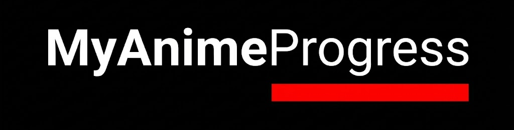
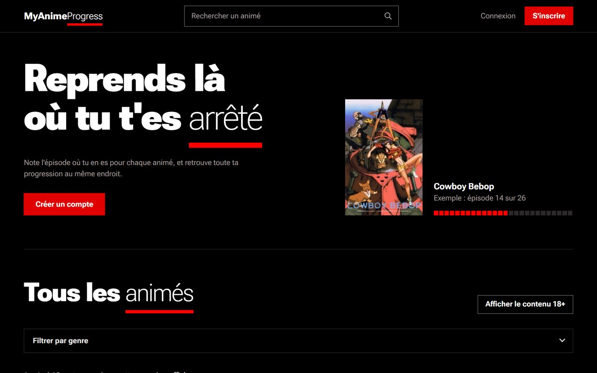
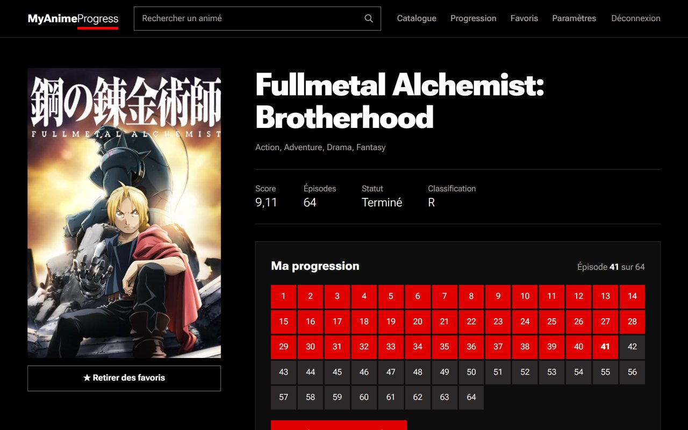
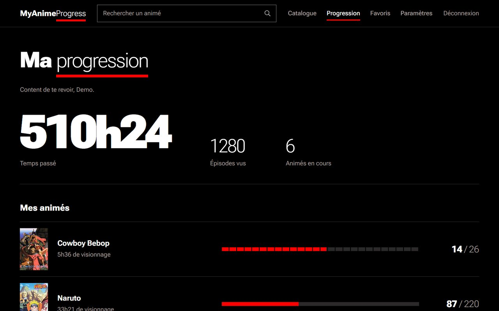
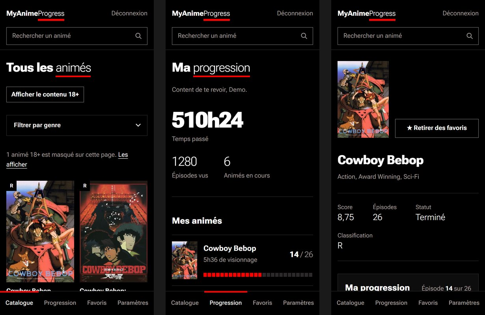
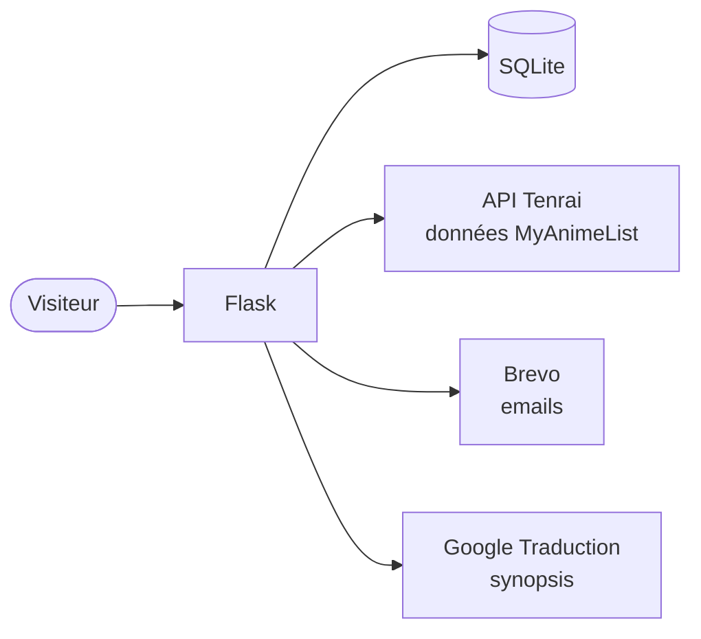

<div align="center">



### Reprends là où tu t'es arrêté.

Note l'épisode où tu en es pour chaque animé,<br>et retrouve toute ta progression au même endroit.

[](https://anime.skayzax.fr)


<br>



</div>

## Sommaire

- [Fonctionnalités](#fonctionnalités)
- [Aperçu](#aperçu)
- [Installation](#installation)
- [Configuration](#configuration)
- [Comment ça marche](#comment-ça-marche)
- [Sécurité](#sécurité)
- [Mise en production](#mise-en-production)
- [À venir](#à-venir)
- [Crédits](#crédits)

## Fonctionnalités

| | |
|---|---|
| **Accueil** | Les plus populaires, les mieux notés et les grands classiques |
| **Catalogue** | Plus de 30 000 animés, 44 genres et une recherche |
| **Progression** | Une case par épisode : clique sur le dernier vu, tout ce qui précède se remplit |
| **Séries en cours** | Le nombre d'épisodes sortis se met à jour tout seul |
| **Bilan** | Temps passé, épisodes vus, animés en cours |
| **Favoris** | Tes animés préférés, avec leur avancement |
| **Suites** | Les saisons d'avant et d'après, en un clic |
| **Synopsis en français** | Traduction automatique |
| **Contenu 18+** | Masqué partout tant que l'âge n'est pas confirmé |
| **Mobile** | Menu à portée de pouce, installable comme une application |

## Aperçu

<table>
  <tr>
    <td width="50%"></td>
    <td width="50%"></td>
  </tr>
  <tr>
    <td align="center"><b>Fiche</b> : une case par épisode</td>
    <td align="center"><b>Progression</b> : ton bilan et tes séries</td>
  </tr>
</table>

<div align="center">
  
  <br><b>Sur mobile</b>
</div>

## Installation

Il te faut **Python 3.11 ou plus récent** et **Git**.

```bash
git clone https://github.com/SkayZax/MyAnimeProgress.git
cd MyAnimeProgress
python -m venv venv
```

Active l'environnement :

```bash
# Windows (PowerShell)
venv\Scripts\Activate.ps1

# Linux et macOS
source venv/bin/activate
```

Installe et lance :

```bash
pip install -r requirements.txt
python app.py
```

Le site est sur **http://127.0.0.1:5000**. La base de données se crée toute seule au premier démarrage.

> [!NOTE]
> Le catalogue marche sans rien configurer. Pour créer un compte, il faut recevoir un code : vois la configuration ci-dessous.

## Configuration

Crée un fichier `.env` à la racine du projet. Il est ignoré par Git : **n'y mets jamais tes secrets ailleurs**.

```dotenv
SECRET_KEY=une-longue-chaine-aleatoire

# Envoi des codes de vérification (https://www.brevo.com)
BREVO_API_KEY=xkeysib-ta-cle
BREVO_FROM_EMAIL=no-reply@exemple.com
BREVO_FROM_NAME=MyAnimeProgress

# En développement : affiche le code à l'écran si l'email ne part pas
DEV_SHOW_VERIFICATION_CODE=1
```

Pour générer une `SECRET_KEY` :

```bash
python -c "import secrets; print(secrets.token_hex(32))"
```

| Variable | Rôle | Obligatoire |
|---|---|---|
| `SECRET_KEY` | Signe les sessions. Sans elle, une clé temporaire est créée et tout le monde est déconnecté à chaque redémarrage | En production |
| `BREVO_API_KEY` | Clé API Brevo, pour envoyer les codes | Pour les emails |
| `BREVO_FROM_EMAIL` | Adresse d'envoi, validée dans Brevo | Pour les emails |
| `BREVO_FROM_NAME` | Nom affiché de l'expéditeur | Non |
| `BREVO_TEMPLATE_ID` | Modèle d'email Brevo à utiliser | Non |
| `BREVO_TIMEOUT` | Délai maximal d'envoi, en secondes (10 par défaut) | Non |
| `COOKIE_SECURE` | `1` en HTTPS : le cookie de session ne circule jamais en clair | En production |
| `DEV_SHOW_VERIFICATION_CODE` | `1` pour afficher le code si l'email échoue. **Jamais en production** | Non |

> [!TIP]
> Brevo désactive une clé restée 90 jours sans servir. Si les emails ne partent plus, regarde d'abord de ce côté.

## Comment ça marche



Les infos des animés suivis sont gardées en base. La page Progression n'appelle donc presque jamais l'API, et s'affiche même quand celle-ci est en panne.

```text
MyAnimeProgress/
├── app.py              Routes, modèles et migrations
├── securite.py         Limite d'essais et mots de passe refusés
├── classiques.py       Animés de l'onglet Classiques, choisis à la main
├── nouveautes.py       Notes de mise à jour de la pop-up Nouveautés
├── api/
│   └── API.py          Client de l'API Tenrai
├── templates/          Pages (Jinja), bâties sur base.html
├── static/             Feuille de style, script, icônes, manifeste PWA
├── docs/               Images de ce README
└── requirements.txt    Dépendances
```

### La direction artistique

Tout part du logo : **noir pur**, **deux graisses** de Roboto Flex et **une barre rouge**. Le rouge ne veut dire que trois choses : progression, action principale ou alerte.

## Sécurité

- Mots de passe hachés, 8 caractères minimum, les plus courants refusés
- Email vérifié par un code à usage unique, annulé après 5 erreurs
- Nombre d'essais limité sur la connexion, l'inscription et les codes
- Jeton CSRF sur tous les formulaires
- Sessions révoquées côté serveur à la déconnexion
- Cookies `HttpOnly` et `SameSite`, `Secure` en HTTPS
- En-têtes de sécurité : CSP, HSTS, `X-Frame-Options`…

Tu as trouvé une faille ? Merci de **ne pas ouvrir d'issue publique** et de me contacter directement.

## Mise en production

```bash
gunicorn --workers 1 --threads 4 --timeout 90 --bind 127.0.0.1:8001 app:app
```

> [!IMPORTANT]
> Garde **un seul worker** : les compteurs d'essais vivent en mémoire. Augmente plutôt `--threads`.

À faire aussi :

- placer un serveur comme nginx devant, en HTTPS, qui transmet `Host`, `X-Forwarded-For` et `X-Forwarded-Proto` ;
- mettre `COOKIE_SECURE=1` et une vraie `SECRET_KEY` ;
- installer le projet **hors du dossier public** du serveur web ;
- sauvegarder `instance/database.db`.

## À venir

- [x] Mot de passe oublié (code envoyé par email)
- [x] Page de paramètres : pseudo, mot de passe, contenu 18+
- [x] Suppression du compte
- [ ] Changement d'adresse email
- [ ] Page de confidentialité

## Crédits

- Données : [API Tenrai](https://tenrai.org), compatible Jikan v4, à partir de [MyAnimeList](https://myanimelist.net)
- Emails : [Brevo](https://www.brevo.com)
- Police : [Roboto Flex](https://fonts.google.com/specimen/Roboto+Flex)

Projet personnel, sans lien avec MyAnimeList. Les affiches et les titres appartiennent à leurs ayants droit.

<div align="center">
<br>

Fait par [SkayZax](https://github.com/SkayZax)

</div>
